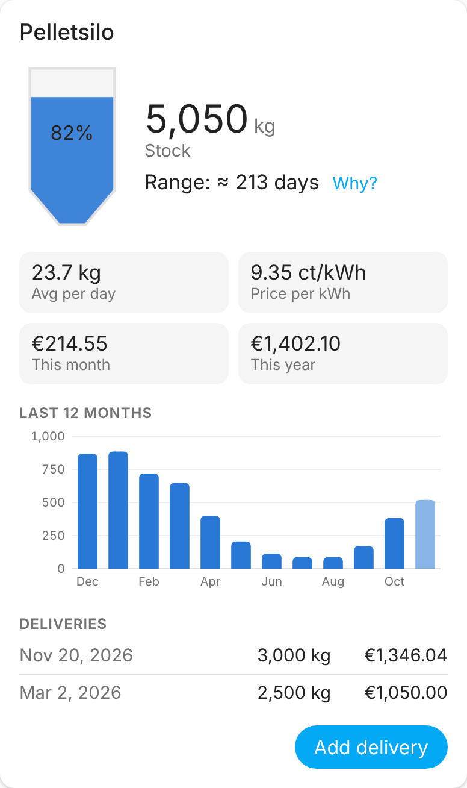
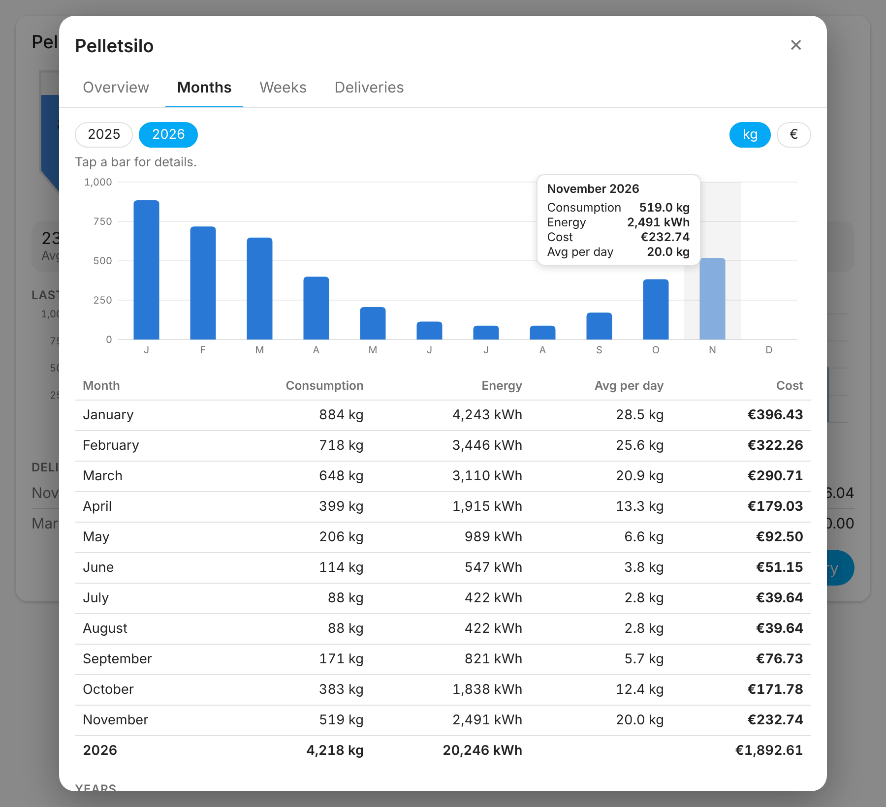
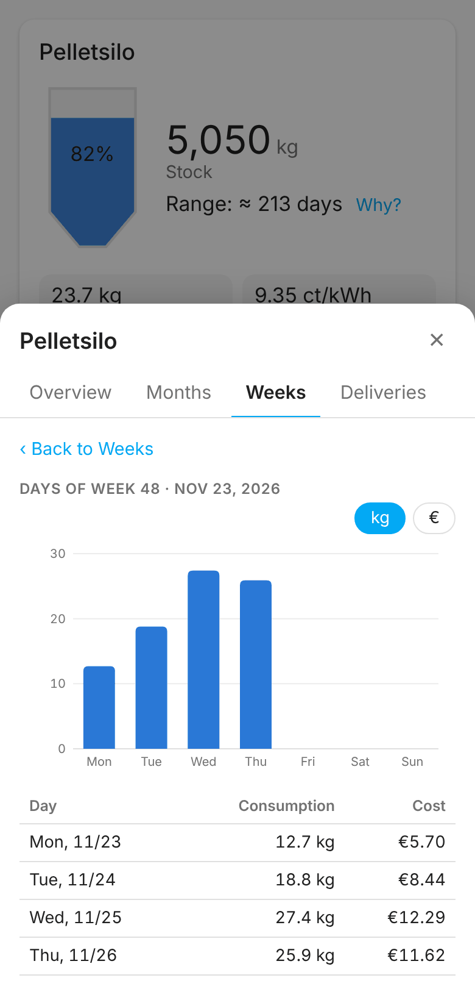
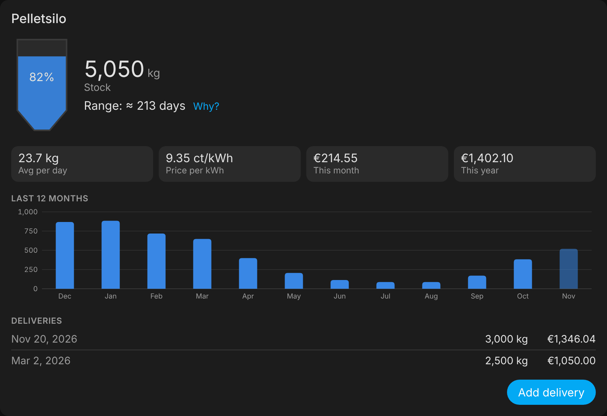

# Pellet Stock Manager for Home Assistant

[](https://github.com/PXLJAKE/ha-pellet-stock/actions/workflows/ci.yml)
[](https://github.com/PXLJAKE/ha-pellet-stock/releases/latest)
[](https://hacs.xyz/)
[](LICENSE)

Pellet Stock Manager keeps track of your wood pellet storage in Home Assistant. It shows how much is left, how long it will last, what heating costs per month and what a kWh costs. It works with any pellet boiler or stove, whatever the brand, because it reads sensors your heating already has in Home Assistant.

**Project page and full documentation: [pxljake.com/projects/Pellet-tracker](https://pxljake.com/projects/Pellet-tracker)**



## What it does

- **Any heating.** Consumption comes from a kg counter (daily or total), an energy counter in kWh, or the burner runtime.
- **Stock and range.** The range uses the average of the last 14 full days. Every value has a plain-language **"Why?"** explanation.
- **Costs.** Average price from your deliveries, cost per month and year, and a price per kWh for the Energy dashboard.
- **Deliveries.** Enter them on the card or with an action, and correct or delete wrong entries.
- **History from day one.** Past consumption is taken over from the Home Assistant statistics of your sensor.
- **Low stock warning.** A binary sensor and the event `pellet_stock_low_stock` for your own notifications.
- **Dashboard card included.** Silo graphic, key figures, 12-month chart and a popup with months, weeks and days.
- **Light on your system.** Event-driven, no polling, few disk writes, nothing sent to the internet.
- **German and English.**

| Analysis popup | On a phone |
|---|---|
|  |  |

## Installation

Home Assistant 2026.10 or newer is required.

### HACS

[](https://my.home-assistant.io/redirect/hacs_repository/?owner=PXLJAKE&repository=ha-pellet-stock&category=integration)

1. In HACS, open the menu (⋮), choose **Custom repositories**, and add `https://github.com/PXLJAKE/ha-pellet-stock` with the type **Integration**. The button above does this for you.
2. Search for **Pellet Stock Manager** and download it.
3. Restart Home Assistant.

### Manual

1. Download `pellet_stock-<version>.zip` from the [latest release](https://github.com/PXLJAKE/ha-pellet-stock/releases/latest).
2. Unpack it into `custom_components/pellet_stock` in your Home Assistant configuration.
3. Restart Home Assistant.

## Setup

Go to **Settings → Devices & services → Add integration** and choose **Pellet Stock Manager**. The assistant has four steps, and every field explains what it does:

1. **Name and source.** Where the consumption comes from.
2. **Source details.** The sensor, the calorific value (default 4.8 kWh/kg) and the largest plausible step (default 10 kg).
3. **Storage.** Size, minimum stock (default 10 %) and an optional fill level or scale sensor.
4. **Start values.** Current stock, price per tonne, and whether to take over the history.

You can change everything later under **Configure**, and stock and history are kept. Each storage gets its own entry, so you can add as many as you need.

## Dashboard card

The card is loaded automatically, with no resource to add. Edit a dashboard, choose **Add card**, search for **Pellet Stock** and pick your storage. Tap the card to open the analysis popup.

```yaml
type: custom:pellet-stock-card
device: <device id>          # chosen in the visual editor
```



## Entities and actions

Each storage is a device with sensors for stock, fill level, range, average and daily consumption, total consumption, energy, price per kWh, average price per tonne, cost this month and this year, and the last delivery, plus the binary sensor *Minimum stock reached*.

| Action | What it does |
|---|---|
| `pellet_stock.add_delivery` | Adds a delivery (`kg`, optional `price`, `date`, `note`) |
| `pellet_stock.correct_stock` | Sets the stock to what is really in the storage |
| `pellet_stock.delete_delivery` | Removes a wrong delivery |
| `pellet_stock.import_history` | Takes over past consumption from the statistics, once per storage |

The documentation describes every setting, entity and option, with a FAQ and troubleshooting, in English and German. Its sources are in [`docs/`](docs/en/index.md).

## Contributing

Issues and pull requests are welcome, see [CONTRIBUTING.md](CONTRIBUTING.md). Changes are listed in the [CHANGELOG](CHANGELOG.md).

## License

[Apache License 2.0](LICENSE)
