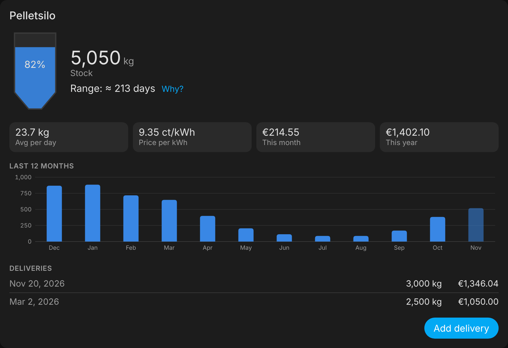
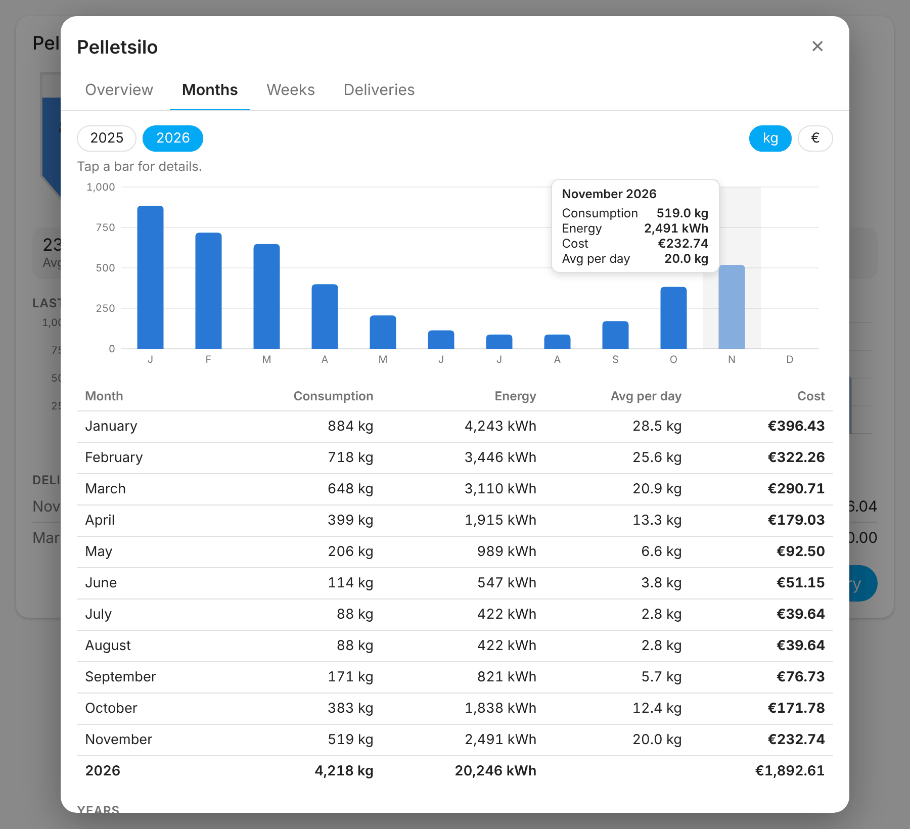
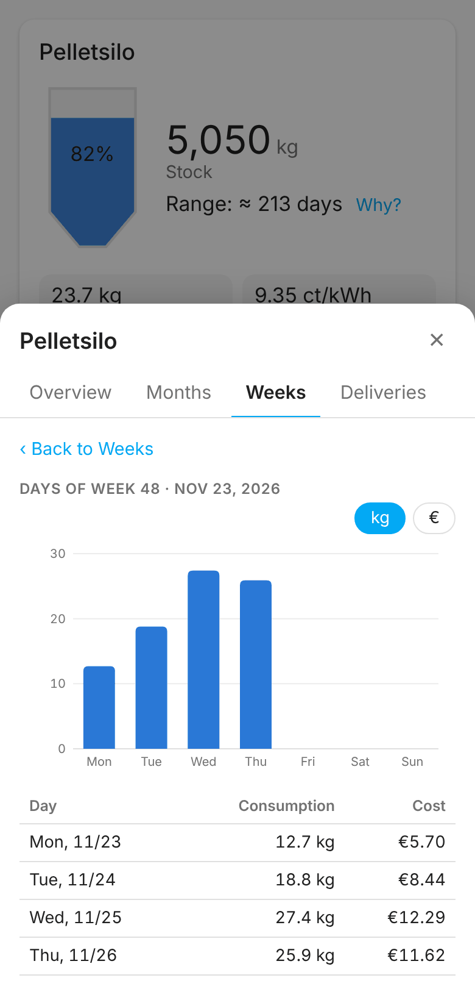

# Dashboard-Karte

Die Karte wird mit der Integration geliefert und automatisch geladen. Du trägst keine Ressource ein.

## Hinzufügen

1. Bearbeite ein Dashboard und wähle **Karte hinzufügen**.
2. Suche nach **Pellet Stock** und wähle im visuellen Editor dein Lager.

{ width="720" }

Die Karte folgt deinem hellen oder dunklen Theme und passt auf Handy, Tablet und Desktop.

## Optionen

Alle Optionen gibt es im visuellen Editor. In YAML:

```yaml
type: custom:pellet-stock-card
device: <Geräte-ID>          # im visuellen Editor gewählt
title: Pelletsilo            # optional
show_stats: true             # Kennzahlen
show_chart: true             # letzte 12 Monate
show_history: true           # Lieferungen
show_add_button: true        # Knopf „Lieferung eintragen“
history_count: 3             # Anzahl Lieferungen, 1 bis 10
```

## Auswertung im Popup

Tipp auf die Karte, um die Auswertung zu öffnen. Sie hat Übersicht, Monate, Wochen und Lieferungen:

- Balkendiagramme für Verbrauch oder Kosten pro Monat. Tipp auf einen Monat für seine Tage.
- Die letzten 26 Wochen. Tipp auf eine Woche für ihre Tage.
- Tabellen und Jahressummen.

| Monate | Tage einer Woche auf dem Handy |
|---|---|
| { width="480" } | { width="220" } |

Die Karte lädt diese Daten erst, wenn sie gebraucht werden. Der Verlauf wird nicht im Recorder gespeichert.
