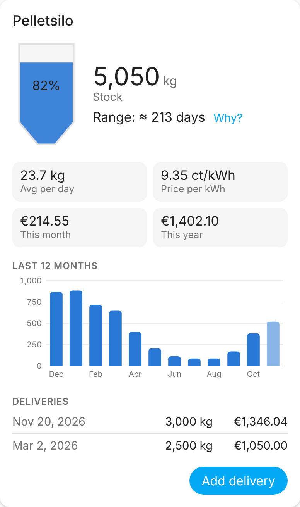

# Pellet Stock Manager

Pellet Stock Manager behält dein Pelletlager in Home Assistant im Blick. Du siehst, wie viel noch da ist, wie lange es reicht, was das Heizen im Monat kostet und was eine kWh kostet. Es funktioniert mit jedem Pelletkessel oder Pelletofen, egal von welchem Hersteller, weil es Sensoren liest, die deine Heizung schon in Home Assistant hat.

{ width="360" }

## Was du brauchst

- Home Assistant 2026.10 oder neuer.
- Eines davon von deiner Heizung, schon in Home Assistant:
    - einen Sensor, der verbrauchte Pellets in kg zählt (Gesamtzähler oder Tageszähler, der um Mitternacht auf 0 springt),
    - einen Sensor, der Energie in kWh zählt,
    - eine Ein/Aus-Entität, die zeigt, dass der Brenner läuft, oder einen Sensor mit Betriebsstunden.

## Mit HACS installieren

1. Öffne in HACS das Menü (⋮), wähle **Benutzerdefinierte Repositories** und füge `https://github.com/PXLJAKE/ha-pellet-stock` mit dem Typ **Integration** hinzu.
2. Suche nach **Pellet Stock Manager** und lade es herunter.
3. Starte Home Assistant neu.

## Von Hand installieren

1. Lade `pellet_stock-<version>.zip` vom [neuesten Release](https://github.com/PXLJAKE/ha-pellet-stock/releases/latest) herunter.
2. Entpacke es in den Ordner `custom_components/pellet_stock` deiner Home-Assistant-Konfiguration.
3. Starte Home Assistant neu.

## Dein Lager anlegen

1. Gehe zu **Einstellungen → Geräte & Dienste → Integration hinzufügen**.
2. Wähle **Pellet Stock Manager**.
3. Folge den vier Schritten des Assistenten. Jedes Feld erklärt, was es tut, und unter [Konfiguration](configuration.md) sind alle beschrieben.

Jedes Lager bekommt einen eigenen Eintrag. Du kannst beliebig viele anlegen.

## Die Karte hinzufügen

Die Dashboard-Karte wird mit der Integration geliefert. Du musst keine Ressource eintragen.

1. Bearbeite ein Dashboard und wähle **Karte hinzufügen**.
2. Suche nach **Pellet Stock** und wähle dein Lager.

Fehlt die Karte in der Liste, lade die Browserseite einmal neu. Mehr dazu unter [Fehlersuche](troubleshooting.md#die-karte-fehlt).

## Datenschutz und Ressourcen

- Alle Daten bleiben in Home Assistant. Nichts wird ins Internet geschickt.
- Die Diagnose blendet deine Liefernotizen aus.
- Die Integration arbeitet ereignisgesteuert und fragt nichts zyklisch ab. Daten werden höchstens alle 15 Minuten geschrieben, das schont SD-Karten. Lieferungen werden sofort gespeichert.
- Die Karte ist eine einzelne Datei mit etwa 13 KB (gzip) ohne Abhängigkeiten.
