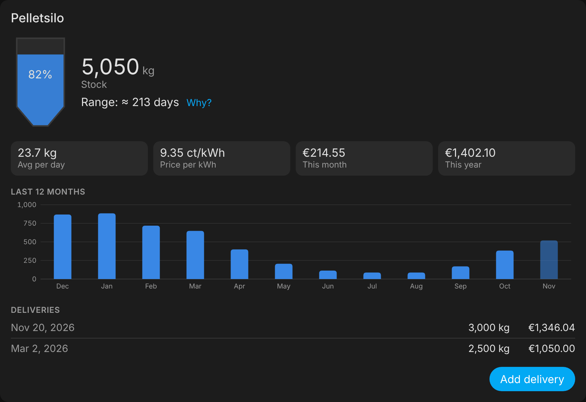
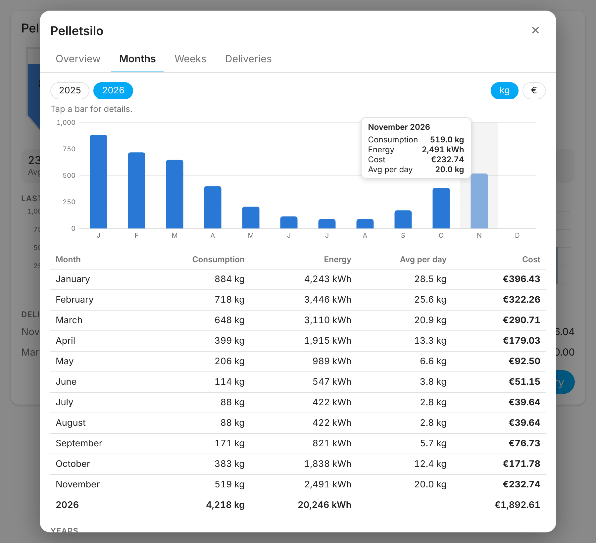
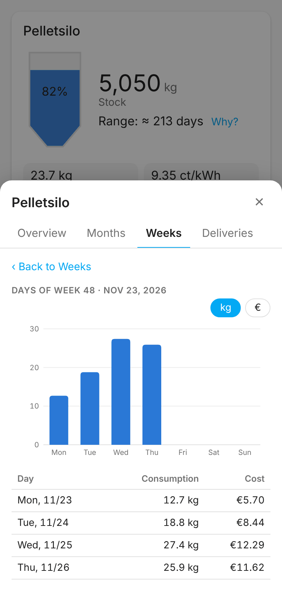

# Dashboard card

The card comes with the integration and is loaded automatically. You do not add a resource.

## Add it

1. Edit a dashboard and choose **Add card**.
2. Search for **Pellet Stock** and pick your storage in the visual editor.

{ width="720" }

The card follows your light or dark theme and fits phones, tablets and desktops.

## Options

All options are in the visual editor. In YAML:

```yaml
type: custom:pellet-stock-card
device: <device id>          # chosen in the visual editor
title: Pellet silo           # optional
show_stats: true             # key figures
show_chart: true             # last 12 months
show_history: true           # deliveries
show_add_button: true        # "Add delivery" button
history_count: 3             # number of deliveries, 1 to 10
```

## Analysis popup

Tap the card to open the analysis. It has an overview, months, weeks and deliveries:

- Bar charts for consumption or cost per month. Tap a month to see its days.
- The last 26 weeks. Tap a week to see its days.
- Tables and yearly totals.

| Months | Days of a week on a phone |
|---|---|
| { width="480" } | { width="220" } |

The card loads this data only when it is needed. The history is not stored in the recorder.
