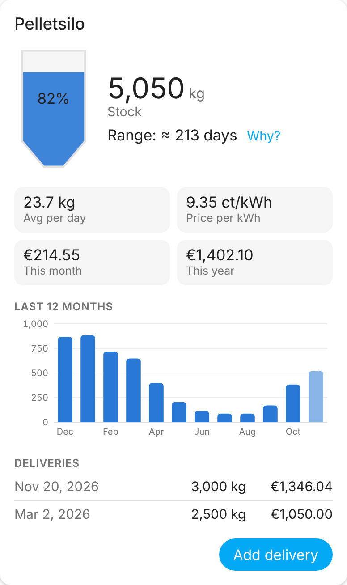

# Pellet Stock Manager

Pellet Stock Manager keeps track of your wood pellet storage in Home Assistant. It shows how much is left, how long it will last, what heating costs per month and what a kWh costs. It works with any pellet boiler or stove, whatever the brand, because it reads sensors your heating already has in Home Assistant.

{ width="360" }

## What you need

- Home Assistant 2026.10 or newer.
- One of these from your heating, already in Home Assistant:
    - a sensor that counts used pellets in kg (a running total, or a daily counter that resets at midnight),
    - a sensor that counts energy in kWh,
    - an on/off entity that shows the burner is running, or a sensor with burner hours.

## Install with HACS

1. In HACS, open the menu (⋮), choose **Custom repositories**, and add `https://github.com/PXLJAKE/ha-pellet-stock` with the type **Integration**.
2. Search for **Pellet Stock Manager** and download it.
3. Restart Home Assistant.

## Install by hand

1. Download `pellet_stock-<version>.zip` from the [latest release](https://github.com/PXLJAKE/ha-pellet-stock/releases/latest).
2. Unpack it into the folder `custom_components/pellet_stock` of your Home Assistant configuration.
3. Restart Home Assistant.

## Add your storage

1. Go to **Settings → Devices & services → Add integration**.
2. Choose **Pellet Stock Manager**.
3. Follow the four steps of the assistant. Every field explains what it does, and [Configuration](configuration.md) describes them all.

Each storage gets its own entry, so you can add as many as you need.

## Add the card

The dashboard card comes with the integration. You do not need to add a resource.

1. Edit a dashboard and choose **Add card**.
2. Search for **Pellet Stock** and pick your storage.

If the card is not in the list, reload the browser page once. See [Troubleshooting](troubleshooting.md#the-card-is-missing).

## Privacy and resources

- All data stays in Home Assistant. Nothing is sent to the internet.
- Diagnostics hide your delivery notes.
- The integration is event-driven and does not poll. Data is written at most every 15 minutes, which is kind to SD cards. Deliveries are saved right away.
- The card is a single file of about 13 KB (gzipped) with no dependencies.
